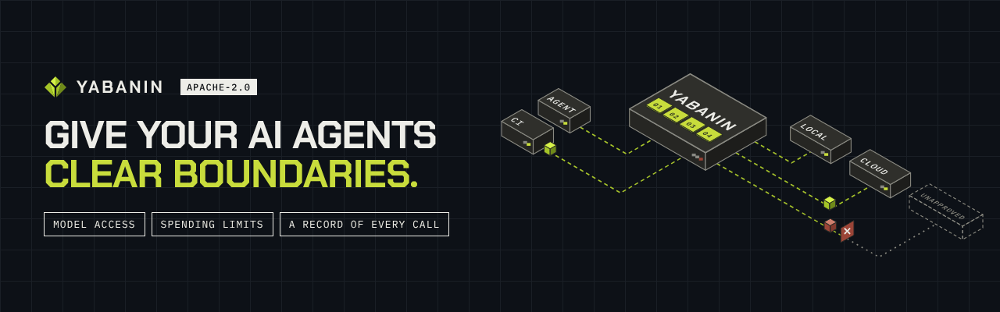

# Yabanin Core



**Website:** <https://yabanin.ai>
Yabanin Core is a self-hosted AI gateway. Connect applications through
OpenAI-compatible or Anthropic-compatible APIs, route requests to model
providers, manage access and budgets, and inspect request logs and usage.

This is a **Developer Preview**. Read the release notes before deploying it
with production traffic. Protocol support and client verification levels are
recorded in the [compatibility matrix](docs/compatibility.md); a feature's
presence in source is not a claim of production readiness.

Preview history is temporary: when the first major version is released, the
`main` branch will be squashed. Do not base durable forks or branches on
individual preview commits; track release tags instead.

## Feature highlights

- **One API for multiple providers.** OpenAI-compatible and Anthropic-compatible
  endpoints, streaming, and tool calling; bring your own provider keys with
  [BYOK](docs/byok.md). See [client compatibility](docs/compatibility.md) for
  endpoint coverage.
- **Automatic model routing.** Match prompt complexity to cheap, mid, or premium
  model pools, balance requests across pool members, and override routing per
  organization. Inspect the final model choice and routing reasons through
  `X-Yabanin-Decision`. [Task classifier](docs/classifier.md)
- **Retries and fallback.** Retry eligible failures, switch to configured fallback
  models, and use circuit breakers for failing upstreams.
  [Request path](docs/architecture.md)
- **Exact and semantic caching.** Reuse cached responses with streaming replay;
  optional semantic matching uses an embedder and pgvector.
  [Caching](docs/cache.md)
- **Access and spend controls.** Organization roles, API keys, rate limits,
  credits, and budget caps keep shared model access manageable.
  [Organization setup](docs/organization-setup.md)
- **Usage beyond dollars.** View recorded USD cost, wallet credits, tokens and
  factor-based CO₂e estimates in one organization-scoped report. Keep scenario
  costs separate from recorded spend, with data-quality labels and coverage
  notices. [Usage and impact accounting](docs/usage-and-impact.md)
- **Versioned pricing with provenance.** Inspect the active price catalog,
  preview a replacement and promote a reviewed pricing pack. Catalog versions,
  digests and source dates make cost calculations traceable.
  [Pricing and accounting](docs/usage-and-impact.md#prices-and-data-quality)
- **Programmable guardrails.** Compose YAML policies for PII, secrets, and prompt
  injection checks, masking, external scanners, and LLM judges. Preview decisions
  in shadow mode before enforcement; the pipeline is opt-in.
  [Policy pipeline](docs/pipeline.md)
- **Agent governance.** Give agents separate identities, daily budgets, task token
  limits, and delegated keys; control supported tool and MCP calls with
  [tool policies](docs/tool-policies.md).
  [Agent governance](docs/agent-governance.md)
- **Usage visibility and offline audits.** Inspect request history and usage in
  the React dashboard, manage the gateway through the admin API and `yb` CLI,
  and simulate cache reuse and cheaper routing from local logs. Export Markdown,
  JSON or a standalone HTML report without a running gateway or provider calls.
  [Offline spend audit](docs/audit.md)
- **Signed request records.** Optional Ed25519-signed lineage preserves model
  and region-related claims in a tamper-evident ledger. Signatures verify record
  integrity, not the physical location of inference. [Lineage](docs/lineage.md)

Costs depend on configured prices and recorded usage. The bundled reference
prices have limited coverage and may be outdated. Configure current prices
before relying on cost reports. The mock quickstart makes no paid provider calls.

### Cost, resources and environmental estimates

The dashboard's **Budgets → Units & spend** view keeps five quantities separate:

| Quantity | What it represents |
| --- | --- |
| Recorded cost · USD | Recorded request cost under the configured pricing data |
| What-if cost · USD | A counterfactual scenario, not another charge or guaranteed savings |
| Credits spent | Wallet usage settlements; one credit equals USD 0.01 |
| Tokens used | Recorded input and output tokens, with estimated or missing usage identified |
| Estimated CO₂e · grams | Token usage multiplied by configured model carbon factors |

Carbon factors must be supplied by the operator; the quickstart does not include
a populated emissions catalog. CO₂e is a model-based estimate, not a hardware
measurement. Carbon-cap status is informational, and this view does not measure
water or electricity consumption. Monetary accounting remains USD-based; credits
and tokens are separate units, not foreign-exchange conversion. See the
[calculation and coverage details](docs/usage-and-impact.md).

## Current Capabilities

Capabilities with automated-test evidence in this release. Per-endpoint
scope and client-verification levels are recorded in the
[compatibility matrix](docs/compatibility.md).

- **OpenAI-compatible routes**: `/v1/chat/completions` with streaming and
  tool calls, `/v1/completions` (FIM), `/v1/models`, and Batch/Files
  (`/v1/files`, `/v1/batches`).
- **Anthropic-compatible route**: `/v1/messages` with streaming and
  `tool_use`/`tool_result` round-trips - translated to an OpenAI-compatible
  upstream, or forwarded natively to an Anthropic provider.
- **Codex-style route**: `/v1/responses` with custom tool calls, verified
  end-to-end with the real Codex CLI (tools loop, capability errors,
  mid-stream cancel) against a mock upstream; no paid inference needed.
- **A local stack from source**: the [quickstart](docs/quickstart.md) builds
  the stack, creates an organization and keys, serves a request through a
  mock provider, and records it in the request log.
- **Organization controls**: gateway keys, roles, budgets and credits, and
  per-organization provider keys (BYOK) stored encrypted and masked to the
  last four characters.
- **Policies and guards**: fail-closed request-content authorization and
  offline guard packs with staged activation and rollback.
- **Usage and cost insight**: asynchronous request logging with history and
  export, usage-based cost estimates, and the offline `yb audit` spend
  report that runs without a gateway or database.

## In the core

These capabilities ship in this self-hosted Apache-2.0 repository - no hosted
plan, metered feature flag, or per-seat upgrade. Hosted gateways commonly
sell comparable capabilities as paid tiers or enterprise add-ons.

- **Scriptable policy pipeline** ([pipeline](docs/pipeline.md)): declarative
  YAML policies over gateway traffic with 20 builtin detectors and mutators
  (national PII across 10 jurisdictions, secrets, prompt injection, regex and
  JSON-schema checks, redaction, reversible pseudonymization, model rewrite),
  scriptable `when` conditions in three engines - `expr`, sandboxed `lua`,
  `starlark` - a `decide` verdict DSL, SSRF-guarded external HTTP callouts,
  and LLM-judge steps through the gateway's own upstream pool.
  Shadow-to-enforce rollout, per-step timeouts, fail-closed defaults.
- **Policy config-as-code** ([pipeline](docs/pipeline.md)): git is the source
  of truth; `yb policies reconcile` plans and applies changes and reports
  drift; versions are immutable with atomic activation and rollback.
- **Agent governance** ([agent governance](docs/agent-governance.md)):
  agent keys (`yag_*`), per-agent daily budgets, task tags with token caps,
  guard hooks, delegated time-boxed child keys, and the `X-Yabanin-Decision`
  header explaining every routing decision.
- **Classifier-driven routing** ([classifier](docs/classifier.md)): a
  deterministic easy/medium/hard classifier routes simple tasks to cheap
  models, with an optional ML classifier service and KV-cache-aware session
  affinity.
- **Exact + semantic caching** ([cache](docs/cache.md)): Redis exact cache
  plus an optional pgvector semantic layer with per-org privacy modes and A/B
  experiments; semantic reuse needs your embedder and quality evaluation.
- **Shadow mode** ([shadow mode](docs/shadow-mode.md)): replay a sampled
  fraction of real traffic to a candidate model and record its actual cost
  and latency while the client response stays byte-for-byte identical. Off by
  default.
- **Signed lineage** ([lineage](docs/lineage.md)): Ed25519-signed per-request
  attestations of model and region evidence in a tamper-evident per-org hash
  chain, with verification and export; see also
  [residency packs](docs/residency-packs.md) and the
  [sovereign model registry](docs/sovereign-models.md).
- **Tool and MCP governance** ([MCP](docs/mcp-gateway.md) -
  [A2A](docs/a2a-gateway.md) - [tool policies](docs/tool-policies.md)):
  allow-listed external MCP servers with agent-only access and an audit
  trail, deny rules for MCP/A2A and model-declared tool calls, and a
  server-side `web_fetch` executor. Off by default.
- **Admin SSO** ([OIDC](docs/sso-oidc.md)): Authorization Code flow with
  PKCE and fail-closed user mapping - no per-seat enterprise plan required.
- **Offline operations**: the [offline spend audit](docs/audit.md) and
  [evaluation suites](docs/evaluation.md) run without a gateway or provider;
  an [offline bundle](docs/onprem/offline-bundle.md) supports air-gapped
  installs with artifact verification.

## Quickstart with Docker Compose

Start the whole local stand — gateway, PostgreSQL, Redis, a mock model
provider, and the dashboard UI — with one Compose stack. No provider account
or paid inference is needed. The mock returns sample responses so you can try
the API, request logging, and the dashboard. Nothing listens on `0.0.0.0`.

You need Docker with Compose v2, Git, Bash, OpenSSL, curl, and Python 3.
On Windows, use WSL2 with Docker integration. Keep localhost ports **3000**
(dashboard), **8082** (gateway), and **8086** (admin API) and Docker subnet
**10.207.0.0/24** available. The first build downloads Go modules and
container images; you do not need Go or Node.js installed on your computer
(see [First-start timing](#first-start-timing)).

### One command

`bash scripts/quickstart/demo.sh` runs the steps below for you: configure,
build, start, seed, then a summary pointing at the dashboard and where the
API key and admin password were printed. Rerunning it is safe; `--fresh`
wipes the demo database and issues new credentials (destructive). The
numbered steps are the manual path that explains each command.

### 1. Download, configure, and start

```bash
git clone https://github.com/yabaninai/yabanin-core.git
cd yabanin-core

bash scripts/quickstart/init-env.sh

docker compose -f deploy/quickstart/docker-compose.yml \
  --profile mock --profile ui build \
  --build-arg SOURCE_DATE_EPOCH="$(git log -1 --format=%ct)"

docker compose -f deploy/quickstart/docker-compose.yml \
  --profile mock --profile ui up -d --no-build --wait
```

The `mock` profile adds the mock provider; the `ui` profile adds the
containerized dashboard on **http://127.0.0.1:3000**. Omit `--profile ui` for
a leaner stack without the dashboard. Configuration is saved in
`deploy/quickstart/.env`; keep this file with your database between restarts.

### 2. Create your organization and credentials

```bash
bash scripts/quickstart/seed.sh
```

Save the **gateway API key** and **admin password** printed by the command.
They are shown once. The default admin email is `admin@localhost`.

### 3. Send a request

Paste the gateway API key when prompted:

```bash
read -r -s -p "Gateway API key: " YABANIN_API_KEY
printf '\n'

curl --fail-with-body --silent --show-error \
  http://127.0.0.1:8082/v1/chat/completions \
  -H "Authorization: Bearer $YABANIN_API_KEY" \
  -H 'Content-Type: application/json' \
  --data '{"model":"mock-model","stream":false,"messages":[{"role":"user","content":"Hello from Yabanin"}]}'
```

You should receive a chat response with `choices[0].message.content`.
Check model discovery, chat responses, and request logging together:

```bash
bash scripts/quickstart/smoke.sh "$YABANIN_API_KEY"
```

### 4. Open the dashboard

Open **http://127.0.0.1:3000** and sign in with the admin credentials from
step 2 (default email `admin@localhost`). The dashboard container serves the
built UI and proxies `/api` and `/auth` to the admin API on the same origin,
so no local Node.js and no CORS configuration are needed. Port 8086 serves
the admin API itself; it does not serve the dashboard.

The [full quickstart](docs/quickstart.md) covers organization membership,
request history, real providers, and troubleshooting. To iterate on the
dashboard source with hot reload, install Node.js 22 and npm and run in
another terminal:

```bash
npm ci --prefix web/dashboard
npm --prefix web/dashboard run dev -- --host 127.0.0.1
```

Then open **http://127.0.0.1:5173**.

To stop the stack while keeping its database:

```bash
docker compose -f deploy/quickstart/docker-compose.yml \
  --profile mock --profile ui down
```

### First-start timing

With images built once, `up -d --wait` finishes in about ten seconds, and the
`mock-openai` container itself starts in under a second (its health check
polls every two seconds). If the stand appears to hang on the mock, it is
waiting on image transfer or build, not on the service. The first start is
dominated by three things:

- **Image pulls — the largest cost, network-bound.** The builds download the
  pinned `golang` builder image and Alpine, Node, and nginx base images, and
  `up` pulls the pinned PostgreSQL and Redis images; together roughly a
  gigabyte unpacked. On a slow or throttled link to Docker Hub this takes
  minutes and the progress lines sit on `mock-openai` for most of it, which
  is why the mock *looks* like the slow part. Configuring a registry mirror
  is the effective fix.
- **Compilation.** The gateway image downloads all Go modules and compiles
  the whole monorepo (about a minute on a fast machine); the mock image
  compiles its binary. BuildKit layer cache plus the mock's persistent Go
  build cache make later rebuilds take seconds.
- **The dashboard build** runs `npm ci` and the Vite production build (tens
  of seconds).

Restarting later reuses the layer cache and the named database volume, so
`up` returns in seconds.

## Documentation

| Task | Guide |
| --- | --- |
| Understand the request path | [Introduction](docs/intro.md) · [Architecture](docs/architecture.md) |
| Connect an application | [Compatibility](docs/compatibility.md) · [SDKs](docs/clients/sdk-versions.md) |
| Set up access and provider keys | [Organizations](docs/organization-setup.md) · [BYOK](docs/byok.md) |
| Configure routing and policies | [Providers](docs/providers.md) · [Pipeline](docs/pipeline.md) |
| Understand cost, credits, tokens and CO₂e | [Usage and impact accounting](docs/usage-and-impact.md) |
| Inspect a local request log | [Spend audit](docs/audit.md) · [CLI](docs/cli.md) |
| Deploy and operate | [Deployment](docs/deployment-options.md) · [Production runbook](docs/runbooks/production.md) |
| Build and contribute | [Development](docs/DEVELOPMENT.md) · [Contributing](CONTRIBUTING.md) |

## Build from source

Use the Go version declared in `go.mod`, Git, and make:

```bash
make unified yb
./yb --help
```

`yabanin` runs the server components, migrations, and bootstrap commands.
`yb` provides operator commands. For service configuration and tests, see
[Development](docs/DEVELOPMENT.md).

## Security

Keep provider credentials and the generated `.env` file out of Git.
The quickstart is a local demonstration; use deployment-specific secrets and
network settings for production. See [SECURITY.md](SECURITY.md) to report a
vulnerability and the release notes for known issues.

## License

Yabanin Core is licensed under [Apache-2.0](LICENSE), copyright 2026
Dmitry Lakhvich. Commercial use, modification, and redistribution are permitted
under that license. Third-party materials retain their own terms; see
[NOTICE](NOTICE) and [LICENSING.md](LICENSING.md).
The license does not grant rights to the Yabanin trademarks beyond its terms.
