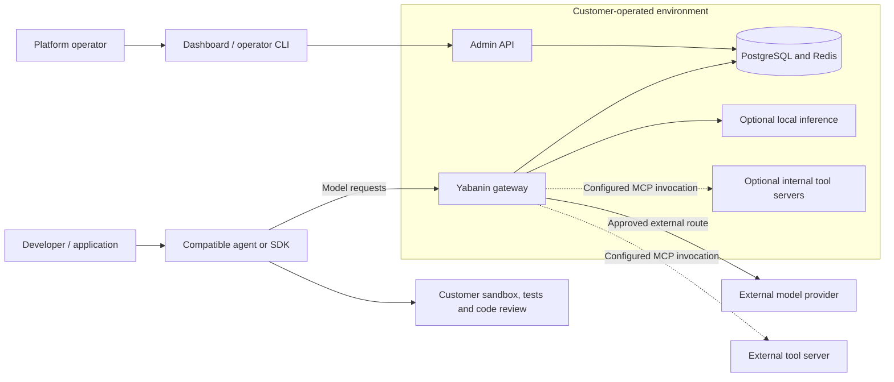
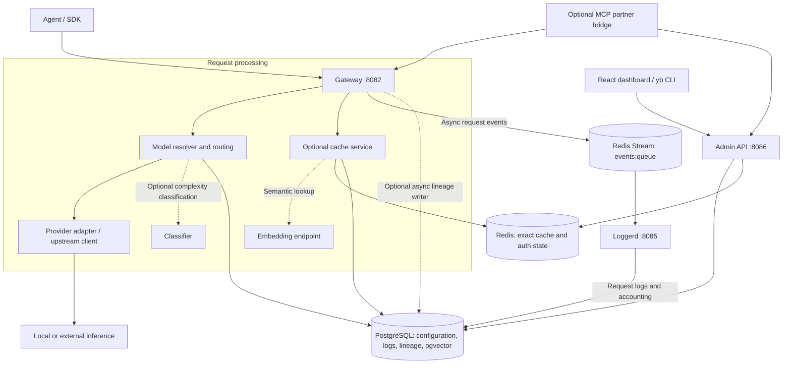
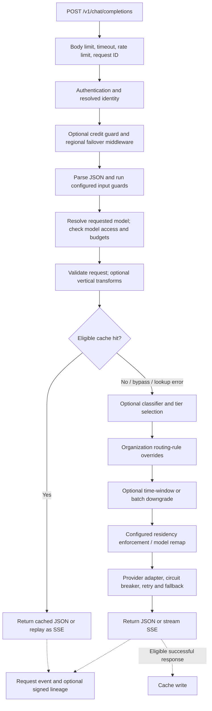
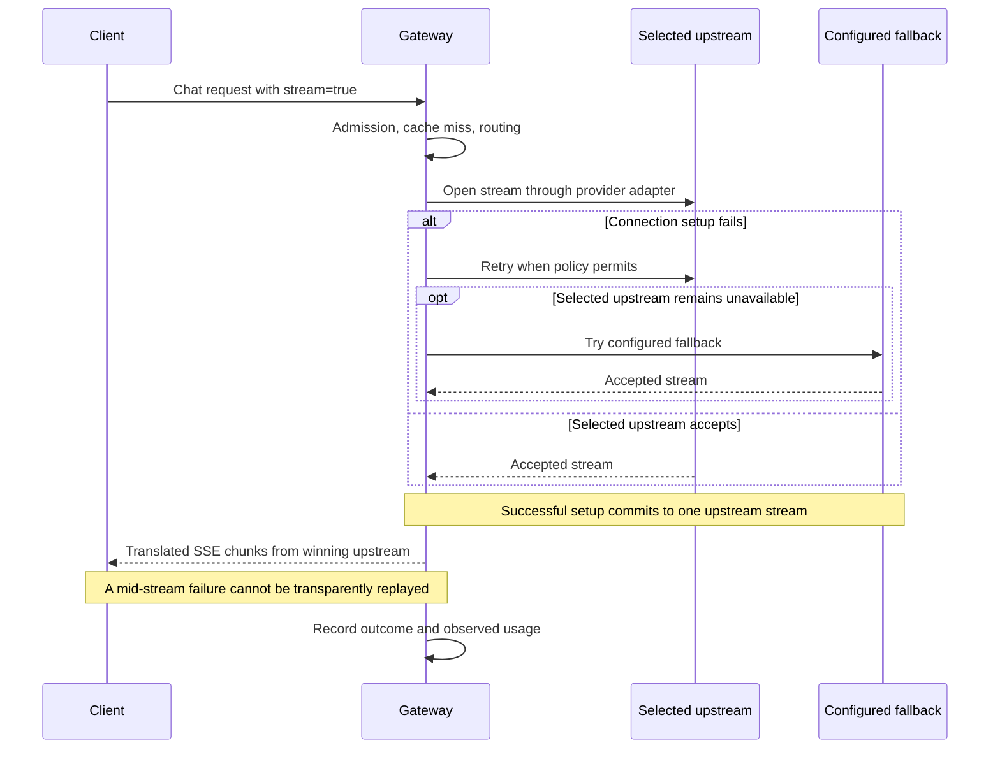
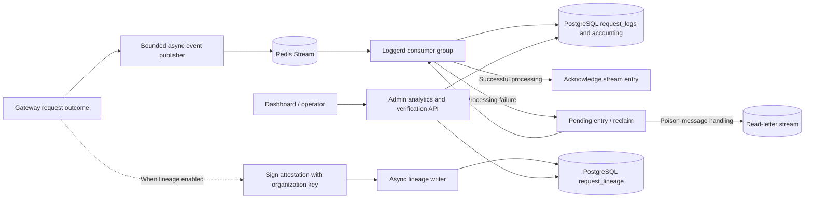
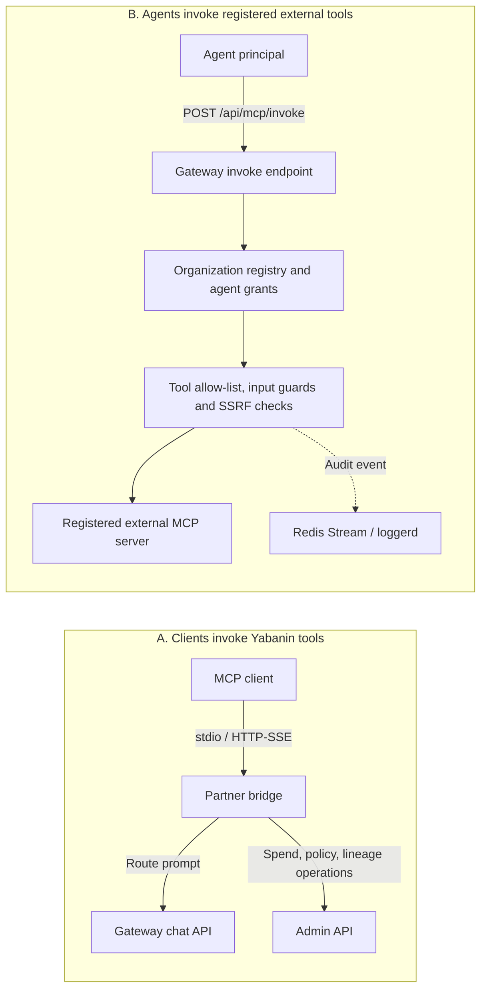
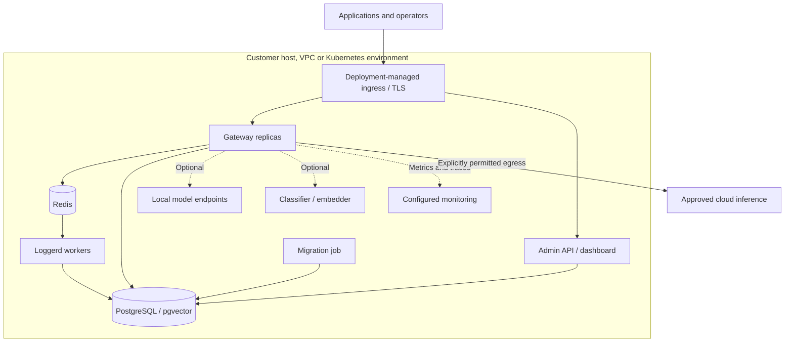

# Solution architecture

Yabanin is a customer-operated AI gateway. Compatible applications and agents send
model requests to it; the gateway applies configured controls, selects an upstream,
forwards the request and records operational evidence. The customer's development
tools remain responsible for editing code, running tests and accepting changes.

This document describes the implementation inspected on **24 September 2026**.
Diagrams are logical views, not a claim that every feature is enabled in every
installation. Optional components require configuration and their dependencies.
Source paths below are relative to the repository root. Mermaid blocks are editable
diagram sources and render in Markdown viewers with Mermaid support.

## 1. System context and ownership

The gateway is an intermediary for traffic sent through its configured endpoints.
It is not an agent runtime, an operating-system sandbox or a replacement for code
review. An agent's direct network calls bypass this boundary unless the deployment
separately restricts them. Self-hosted gateway and local inference are distinct:
an external model route sends request data outside the customer environment.

## 2. Runtime components

Redis cache and Redis Stream are shown separately by responsibility; they can use
the same Redis deployment. The gateway also reads identity, budget and policy data;
the diagram groups those reads with configuration rather than drawing every query.

| Component | Responsibility | Implementation entry points |
| --- | --- | --- |
| Gateway | HTTP middleware, authentication, chat API, routing, streaming, optional MCP invoke API | `services/gateway/cmd/main.go`, `pkg/gateway/gateway.go` |
| Request pipeline | Validation, cache branch, model selection, upstream execution and events | `pkg/gateway/chat.go`, `pkg/gateway/stream.go` |
| Admin | Configuration and identity management, analytics, lineage verification, dashboard backend | `services/admin/handlers/router.go`, `pkg/adminstore` |
| Loggerd | Redis consumer groups, request-log persistence, accounting, pending-message recovery and dead-letter handling | `services/run/loggerd.go`, `services/loggerd/consumer/stream.go` |
| MCP partner bridge | Exposes Yabanin tools to MCP clients; calls gateway/admin APIs | `services/run/mcp.go`, `pkg/mcppartner` |
| PostgreSQL | Durable configuration and operational records; optional semantic-cache vectors | `migrations`, `pkg/migrate/migrations` |
| Redis | Cache, identity-resolution cache, event stream and other configured runtime state | `pkg/cache`, `pkg/auth`, `pkg/eventpublisher` |
| Classifier / embedder | Optional routing classification and semantic-cache embeddings | `pkg/classifier`, `pkg/embeddings`, `deploy/docker-compose.yml` |

The gateway's separate operational listener (default `:9090`) is not the Admin
control-plane service. In the development Compose stack, Admin container port
`:8086` is published as host port `:9091`. The MCP bridge supports stdio and an
optional HTTP-SSE listener on `:8787`; it is not required for ordinary chat calls.

## 3. Chat request path

The principal API is `POST /v1/chat/completions`, with JSON and SSE responses.
The ordering below follows `chatCompletions`; disabled or unwired features are
skipped. Rejection branches terminate the request before the depicted next stage.

### Identity and admission

Authentication removes client-supplied organization, key, team and agent identity
headers before populating them from the resolved principal. Static-key and
database-resolver behavior depends on the configured auth mode; a static key is
not a substitute for an organization/agent identity. See `pkg/gateway/auth.go`.

When wired, model-access and budget checks can reject a request; datastore errors
in these checks do not authorize spending. Team/agent budget checks and later
accounting are separate operations, so this diagram does not imply an atomic
reservation of every concurrent request's eventual cost.

### Cache and routing order

Cache lookup precedes classifier/rule routing and the later residency-enforcement
block in the current handler. A hit returns early. Do not interpret the diagram as
evidence that every post-cache policy is re-evaluated on cached responses. Cache
scope, invalidation and policy changes must be assessed together.

`Cache-Control: no-store` bypasses the gateway cache for the request. An eligible
lookup tries Redis exact matching, optionally PostgreSQL exact matching, and then
semantic matching when enabled by organization policy. Semantic matching uses an
embedding endpoint and pgvector. It is not proof that a reused answer is suitable
for every task. Details: [cache architecture](cache-architecture.md).

On a miss, classification may select a tier, organization rules may override the
selection, and configured time-based routing may change it again before residency
enforcement. These are distinct decisions. Routing-rule read failure currently
logs an error and continues without those rules; it is not a universal fail-closed
policy layer. The model that ultimately responds can also differ after fallback.

### Streaming and retries

This sequence depicts a successful setup through either route. If all setup
attempts fail, the gateway returns an error. Streaming retry/fallback applies only
to connection setup: after accepting the upstream response, it drains that stream
without silently restarting it. Provider-specific raw-body streaming disables
cross-provider fallback. See `pkg/gateway/stream.go` and [provider integration](providers.md).

## 4. Events, storage and evidence

Request logging and lineage have different persistence paths. Loggerd consumes
request events; the gateway's lineage writer appends attestations separately.
The client response does not wait for loggerd to persist its event, and analytics
can lag behind request completion.

Event publication is bounded and best effort: the gateway retries publication,
but can drop an event when its backlog is full or attempts are exhausted. Lineage
creation is also best effort and does not block a request on failure. Consumer
reclaim, deduplication and dead-letter handling do not turn the whole pipeline
into an exactly-once, lossless transaction.

| Record | Meaning | Interpretation boundary |
| --- | --- | --- |
| `model_requested`, `model_used`, routing decision | Requested label, recorded serving model and selection context | A requested model name alone is insufficient to price or compare the executed workload |
| Tokens, duration, first-byte timing and attempts | Observations available on the executed path | Missing fields or interrupted streams are not evidence of zero work or a complete answer |
| Estimated and counterfactual cost | Usage-based price estimate and a modeled alternative | Neither is a provider invoice or guaranteed realized savings |
| Lineage signature and region evidence | Integrity of an attestation and its stated evidence source | A valid signature does not independently prove physical inference location |
| Task / session / agent identifiers | Attribution and correlation | A task tag does not demonstrate that its output passed tests or review |

Prompts, response samples, cache entries, embeddings, event streams and backups
are separate data surfaces. Do not infer that hashing one logged prompt removes
content from all of them. Inspect capture, redaction, retention and endpoint
settings for the actual deployment. See [lineage](lineage.md),
[agent governance](agent-governance.md) and [shadow mode](shadow-mode.md).

Shadow mode is optional, runs sampled comparisons against a candidate model and
does not replace the primary answer. It makes additional inference calls and can
incur additional cost; the candidate route is part of the data-egress boundary.

## 5. Two MCP integration paths

The bridge is a separate integration process. The invoke endpoint is part of the
gateway and is mounted only when the MCP proxy is configured
(`YABANIN_MCP_GATEWAY=1` and a database-backed setup). It requires an agent
principal and enabled server grants; a regular API key is insufficient.

The external invoke path is a supported HTTP tool-call path, not a claim of
universal MCP transport compatibility. It does not spawn upstream stdio servers.
Forwarded agent identity headers are attribution, not upstream credentials.
Input guards do not establish output redaction. Details: [MCP gateway](mcp-gateway.md).

## 6. Deployment and operations

This is a deployment pattern, not a prescribed replica count or an availability
guarantee. Ingress, secrets, backups, resource limits and network policies belong
to the installation. Protect operational listeners independently of client APIs.

| Deployment | Repository assets | Operational meaning |
| --- | --- | --- |
| Local development | `deploy/docker-compose.yml` | Database, Redis, migration job, services and optional inference/monitoring profiles; development exposure is not a production security configuration |
| Kubernetes | `deploy/helm/yabanin` | Configurable service deployment; optional regional topology requires additional configuration |
| On-premises | `deploy/helm/yabanin-onprem` | Customer-operated components with local infrastructure options; air-gap readiness requires checking every dependency and egress path |
| Multi-region | `pkg/regionrouter`, `pkg/regionrepl`, `tests/integration/multiregion` | Optional organization-region handling and replication; separate from retrying a model provider within a request |

The regional gateway middleware can redirect a request with HTTP 307 to a peer or
reject a pinned organization when its region is unavailable. Clients must handle
the selected behavior; this is not an invisible cross-region proxy. See
[multi-region operation](multi-region.md), [deployment options](deployment-options.md)
and the [air-gap checklist](onprem/airgap-checklist.md).

## 7. Source map and review boundaries

| Question | Code to inspect |
| --- | --- |
| Which dependencies and optional features are wired? | `pkg/gateway/gateway.go`, `pkg/config`, `deploy/docker-compose.yml` |
| In what order are chat checks and model choices made? | `pkg/gateway/chat.go` |
| What can retry after streaming starts? | `pkg/gateway/stream.go` |
| How are identities derived? | `pkg/gateway/auth.go`, `pkg/auth` |
| How do cache scope and policy affect a hit? | `pkg/cache/service.go`, `pkg/cache/semantic.go` |
| What happens when publishing or persistence fails? | `pkg/gateway/events.go`, `pkg/eventpublisher/redis_publisher.go`, `services/loggerd/consumer/stream.go` |
| Where is lineage signed and stored? | `pkg/gateway/lineage.go`, `pkg/lineage` |
| Which MCP requests are accepted? | `pkg/gateway/gateway.go`, `pkg/mcpagg/proxy.go`, `services/run/mcp.go` |
| Where do operators change configuration? | `services/admin/handlers/router.go`, `pkg/adminstore`, `web/dashboard` |

Configuration changes may be observed through caches with different lifetimes;
an Admin response is not a global, instantaneous configuration barrier. Verify
propagation and invalidation for the setting being changed.

These diagrams document responsibilities and current code paths. They do not
certify deployment security, model-output quality, customer traction or service
availability. The first adoption step remains one supported workflow with explicit
acceptance checks and observable operating results.
